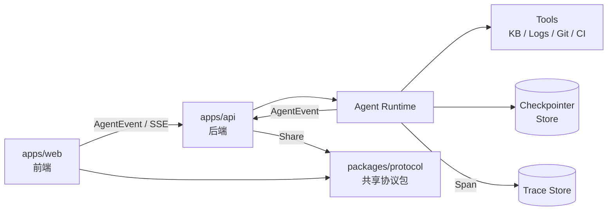

# Agent Workbench（研发 Agent 工作台）

> 从知识库对话到可审计发版。一个用于求职展示的研发 Agent 工作台：Chat 基于工程知识库对话，Release 执行可审计的发版流程。

**状态：M1 进行中。** 技术选型与待确认项见 [docs/decision.md](docs/decision.md)；执行计划见 [docs/plan.md](docs/plan.md)；协议草案见 [docs/protocol.md](docs/protocol.md)。

本文件是产品事实的唯一来源：项目定位、场景、演示流程、功能范围、非目标、当前状态、仓库结构与文档索引。

## 1. 项目是什么

一个产品、两个独立场景，共享同一套 Agent runtime、事件协议和通用能力，但**不合并界面**：

- **Chat**：研发/工程知识库对话，是前端能力的主展示面。覆盖流式渲染、增量 Markdown、长会话性能、异构内容、工具调用、RAG 引用等。
- **Release**：发版工作台，展示确定性工作流 + 有边界的 LLM（合并冲突解决）、人工审批、审计、回滚和可恢复执行。内部带上下文侧边 chat，复用同一套渲染组件。

Chat 可以通过 run 卡片 handoff 到 Release run，对话上下文不丢失。

一句话叙事：**一个研发 Agent 工作台，Chat 基于知识库对话，Release 执行可审计的发版流程。**

## 2. 项目目标

这个项目不是"ChatGPT 换皮"，而是用来展示三件事：

1. **前端工程深度**：流式 Markdown 增量渲染、长会话性能、工具调用状态机、异构内容与海量节点。
2. **Agent 工程能力**：工具循环、上下文工程、记忆、RAG、日志分析、human-in-the-loop、可观测性与评测。
3. **架构判断**：事件协议设计、领域事件与 telemetry 分离、确定性工作流与 LLM 的边界、范围控制。

## 3. 核心演示流程

1. 用户在 Chat 问："1.2.0 发版有哪些注意事项？" → Agent 检索发版规范和 runbook，带引用回答。
2. 用户说："帮我准备发版" → Chat 中插入 run 卡片，进入 Release 工作台。
3. Release 执行前置检查 → 发现合并冲突 → 冲突解决 Agent 给出方案和 diff → 人工审批。
4. 测试失败 → Agent 同时查日志、检索历史故障 runbook → 输出根因、证据和修复建议 → 审批后重跑。
5. Trace / Events 面板展示模型调用、工具调用、检索的耗时与 token；事件流可回放。

## 4. 架构总览



关键设计决策见 [docs/decision.md §1](docs/decision.md#1-架构与协议决策)；技术选型与运行方式见 [docs/decision.md §2](docs/decision.md#2-技术选型与运行方式)。

## 5. 仓库结构（规划）

```
agent-workbench/
├── apps/
│   ├── web/              前端
│   └── api/              后端
├── packages/
│   └── protocol/         共享协议包
├── fixtures/             Chat / Release 场景事件 fixture
├── data/
│   ├── docs/             合成工程文档（知识库）
│   └── logs/             合成故障日志
├── docs/
│   ├── decision.md       决策与理由
│   ├── plan.md           执行计划与阶段状态
│   └── protocol.md       事件协议草案
├── scripts/
│   └── check-docs.mjs    文档一致性检查
├── AGENTS.md             AI Agent 工作规则
├── CLAUDE.md             Claude Code 加载入口
└── README.md
```

## 6. 功能范围

### Chat

- 研发/工程知识库问答：研发规范、架构文档、API、runbook、故障复盘、发版规范。
- 多轮会话：同一 thread 累积多个 run，用户输入与回答都写入事件流。
- 检索是工具，Agent 决定何时查、查几次、是否改写 query。
- 回答带引用；资料不足时明确拒答。
- 保留工具、会话记忆和多步任务能力。

### Release

- 本地玩具仓库 + 模拟 CI，不接真实部署。
- 垂直链路：前置检查 → 冲突解决 Agent → diff 审批 → 测试 → release notes → dry-run tag → 审计 → 回滚。

### 日志与追踪

- 业务日志：Agent 通过工具查询、聚合、定位根因，输出证据和修复建议。
- 运行追踪：Trace 瀑布、Events 原始事件流、回放、token / 耗时 / 成本。
- 日志是横切能力：Chat 与 Release 各有入口，功能复用，作用域不同。

## 7. 非目标

- 不做真实 CI/CD 执行、Kubernetes 或多环境编排。
- 不做通用知识库平台、日志平台或 Agent 平台。
- 不新增第三个业务场景。
- 不使用前雇主的代码、数据、内部 prompt、架构图或系统名。
- 不在第一版实现权限体系、多租户、复杂文档接入。

## 8. 当前阶段

**M1 进行中**：M0 的流式 Chat 已可运行；当前推进块级增量 Markdown、闭合块冻结与长内容虚拟化。

```bash
pnpm install
pnpm dev                    # Vite http://localhost:5173 + Hono http://localhost:8787
pnpm build && pnpm start    # 单 URL http://localhost:8787
```

各阶段状态、交付物、时间盒与退出条件见 [docs/plan.md](docs/plan.md)。

## 9. 文档索引

- [docs/decision.md](docs/decision.md) — 技术选型、架构与范围决策、求职叙事、待确认项、变更记录
- [docs/plan.md](docs/plan.md) — 阶段划分、阶段状态、M0 执行清单、时间盒与验收标准
- [docs/protocol.md](docs/protocol.md) — AgentEvent / Span 协议草案与 fixture 格式
- [AGENTS.md](AGENTS.md) — AI 工作规则与文档来源约定
- [CLAUDE.md](CLAUDE.md) — Claude Code 加载入口

## 10. 数据与合规

- 所有示例数据均为合成数据。
- 文档与日志视为不可信输入，防 prompt injection。
- 发版、回滚等不可逆操作必须人工审批。
